# Agent Swarm Catalog & Specifications

## Personal AI OS Multi-Agent Architecture

This document specifies the declarative configuration, operational capabilities, tool integrations, model assignments, and safety constraints governing each agent in the **Personal AI OS** ecosystem.

---

## 1. Agent Ecosystem Overview

In Personal AI OS, agents are not generic prompts—they are **isolated, typed, stateful actors** defined declaratively via YAML manifests in `agents/<id>/manifest.yaml`. Each agent has explicit tool access lists, memory scopes, model profiles, and permissions.

```
+---------------------------------------------------------------------------------+
|                               TASK DECOMPOSITION                                |
+---------------------------------------------------------------------------------+
                                        |
                                        v
                            +-----------------------+
                            |     ORCHESTRATOR      |
                            | (Planning & DAG Gen)  |
                            +-----------------------+
                                        |
                 +----------------------+----------------------+
                 | (Parallel Branch #1)                        | (Parallel Branch #2)
                 v                                             v
     +-----------------------+                     +-----------------------+
     |      RESEARCH #1      |                     |      RESEARCH #2      |
     | (web_search/fetch_url)|                     | (web_search/fetch_url)|
     +-----------------------+                     +-----------------------+
                 |                                             |
                 +----------------------+----------------------+
                                        | Fan-In Reducer
                                        v
                            +-----------------------+
                            |        WRITER         |
                            |  (Synthesis & Report) |
                            +-----------------------+
                                        |
                                        v
                            +-----------------------+
                            |       VALIDATOR       |
                            | (Grounding & Numbers) |
                            +-----------------------+
                                        |
                                        v
                            +-----------------------+
                            |    VERIFIED OUTPUT    |
                            +-----------------------+
```

---

## 2. Declarative Agent Manifest Schema

Every agent manifest conforms to the shared schema defined in `packages/schemas/python/pos_schemas/agent.py` and `packages/schemas/ts/src/agent.ts`:

```yaml
id: string               # Unique identifier (e.g., 'research', 'writer')
name: string             # Display label in spatial canvas and UI
description: string      # High-level mission and operational context
capabilities: list[str]  # Functional tags (e.g., 'web_research', 'planning')
tools: list[str]         # Allowed MCP and in-process tool identifiers
memory:
  scope: string          # 'none' | 'task' | 'project' | 'personal'
  kind: string           # 'none' | 'kv' | 'vector'
model_profile:
  provider: string       # 'ollama' | 'cloud'
  model: string          # e.g., 'llama3.2:3b', 'phi3.5'
  temperature: float     # e.g., 0.0 for deterministic outputs
  max_tokens: int        # Output length limit
permissions: list[str]   # Explicit authorization capabilities (e.g. 'fs.write')
```

---

## 3. Core Agent Roster

### 3.1 Orchestrator (`orchestrator`)
* **Role:** Chief planner and execution strategist.
* **Manifest:** [agents/orchestrator/manifest.yaml](file:///c:/Users/mpoor/Downloads/multimodel/agents/orchestrator/manifest.yaml)
* **Model:** `llama3.2:3b` (Temperature: `0.0`, Max Tokens: `1024`)
* **Capabilities:** `planning`, `delegation`, `aggregation`
* **Tools:** None (delegates all I/O to specialist agents)
* **Memory Scope:** `project` (Scope: Key-Value)
* **Permissions:** `memory.read`, `memory.write`
* **Execution Details:**
  * Analyzes prompt structure using query classifier heuristics (`taskshape.py`).
  * Emits dependency DAGs (`PlanStep` with `depends_on` relationships).
  * Automatically isolates single-fact queries to a single research branch, and comparative multi-entity prompts to parallel branches (`research#1`, `research#2`).

### 3.2 Research (`research`)
* **Role:** Knowledge acquisition and web information extraction.
* **Manifest:** [agents/research/manifest.yaml](file:///c:/Users/mpoor/Downloads/multimodel/agents/research/manifest.yaml)
* **Model:** `llama3.2:3b` (Temperature: `0.0`, Max Tokens: `2048`)
* **Capabilities:** `web_research`, `summarisation`, `citation`
* **Tools:** `web_search`, `fetch_url`, `memory_write`
* **Memory Scope:** `task` (Scope: Vector)
* **Permissions:** `net.read`, `memory.read`, `memory.write`
* **Execution Details:**
  * Queries DuckDuckGo / Wikipedia without API keys via in-process MCP servers.
  * Validates destination hosts, caps downloads at 2 MB, and enforces 15-second timeouts.
  * Emits raw evidence passages with source indices (`[1]`, `[2]`).

### 3.3 Writer (`writer`)
* **Role:** Document synthesis and report drafting.
* **Manifest:** [agents/writer/manifest.yaml](file:///c:/Users/mpoor/Downloads/multimodel/agents/writer/manifest.yaml)
* **Model:** `llama3.2:3b` (Temperature: `0.0`, Max Tokens: `400`)
* **Capabilities:** `drafting`, `formatting`
* **Tools:** `fs_write`
* **Memory Scope:** `task` (None)
* **Permissions:** `fs.write` (Requires human approval)
* **Execution Details:**
  * Transforms raw research passages into concise, structured Markdown summaries.
  * Enforces citation mapping: every substantive claim cites a numbered source.
  * If requested to save files to disk, execution pauses until the user approves in the UI.

### 3.4 Validator (`validator`)
* **Role:** Quality assurance, fact-checking, and grounding auditor.
* **Manifest:** [agents/validator/manifest.yaml](file:///c:/Users/mpoor/Downloads/multimodel/agents/validator/manifest.yaml)
* **Model Profile:** `phi3.5` (Temperature: `0.0`, Max Tokens: `1024`) / Rule-Based Evaluator
* **Capabilities:** `schema_validation`, `fact_check`
* **Tools:** None (Strictly read-only auditor)
* **Memory Scope:** `task` (None)
* **Permissions:** None (Completely unprivileged)
* **Execution Details:**
  * Runs rule-based grounding checks ([grounding.py](file:///c:/Users/mpoor/Downloads/multimodel/apps/api/app/agent_runtime/grounding.py)) without model hallucination risks.
  * Normalizes numerical expressions (`8,849 == 8849`) and temperatures/units.
  * Re-attaches citations if a misattributed sentence matches terms uniquely from a fetched passage.
  * Forces honest refusal (`"Could not verify"`) when sources are missing or inconsistent.

### 3.5 Memory Keeper (`memory`)
* **Role:** Cross-session memory and context retrieval manager.
* **Manifest:** [agents/memory/manifest.yaml](file:///c:/Users/mpoor/Downloads/multimodel/agents/memory/manifest.yaml)
* **Model:** `llama3.2:3b` (Temperature: `0.0`, Max Tokens: `512`)
* **Capabilities:** `recall`, `store`
* **Tools:** `memory_search`, `memory_write`
* **Memory Scope:** `project` (Scope: Key-Value)
* **Permissions:** `memory.read`, `memory.write`
* **Execution Details:**
  * Interfaces with SQLite FTS5 text tables and optional `nomic-embed-text` vector indices.
  * Segregates project memories strictly by `project_id`, ensuring zero cross-project leakage.

### 3.6 Coder (`coder`)
* **Role:** Software generation, code analysis, and script execution.
* **Manifest:** [agents/coder/manifest.yaml](file:///c:/Users/mpoor/Downloads/multimodel/agents/coder/manifest.yaml)
* **Model:** `phi3.5` (Temperature: `0.0`, Max Tokens: `2048`)
* **Capabilities:** `code_generation`, `code_execution`
* **Tools:** `terminal`, `fs_read`
* **Memory Scope:** `task` (None)
* **Permissions:** `fs.read`, `terminal.exec` (Gated by human approval)
* **Execution Details:**
  * Formulates executable scripts and test harnesses.
  * Execution in the terminal is strictly quarantined and gated behind explicit approval modals.

---

## 4. Permissions & Capabilities Matrix

| Agent | `net.read` | `fs.read` | `fs.write` | `terminal.exec` | `memory.read` | `memory.write` | Approval Required? |
| :--- | :---: | :---: | :---: | :---: | :---: | :---: | :---: |
| **Orchestrator** | ❌ | ❌ | ❌ | ❌ | ✅ | ✅ | No |
| **Research** | ✅ | ❌ | ❌ | ❌ | ✅ | ✅ | No |
| **Writer** | ❌ | ❌ | ✅ | ❌ | ❌ | ❌ | **Yes (`fs.write`)** |
| **Validator** | ❌ | ❌ | ❌ | ❌ | ❌ | ❌ | No |
| **Memory** | ❌ | ❌ | ❌ | ❌ | ✅ | ✅ | No |
| **Coder** | ❌ | ✅ | ❌ | ✅ | ❌ | ❌ | **Yes (`terminal.exec`)** |

---

## 5. Self-Healing & Fault Recovery Protocol

To ensure 100% execution reliability on local models, all agent outputs pass through the unified self-healing engine ([apps/api/app/agent_runtime/heal.py](file:///c:/Users/mpoor/Downloads/multimodel/apps/api/app/agent_runtime/heal.py)):

```mermaid
flowchart TD
    Invoke[Agent Emits Output] --> Validate{Pydantic Schema Validation}
    Validate -- Valid --> Done[Proceed to Next Pipeline Step]
    Validate -- Invalid --> CheckRetry{First Failure?}
    CheckRetry -- Yes --> AppendError[Append ValidationError Details to Context]
    AppendError --> Retry[Re-query Model with Feedback]
    Retry --> Validate
    CheckRetry -- No --> Fallback[Apply Typed Safe Fallback Payload]
    Fallback --> Done
```



1. **Strict Grammar Enforcement:** Model generation is bound to Pydantic JSON schemas.
2. **One-Shot Self-Healing:** On validation failure, the exact schema error message is injected back into the prompt for a single retry.
3. **Guaranteed Fallback:** If the retry fails, a safe typed fallback object is emitted, preventing crashes or unhandled exceptions across the entire swarm.
