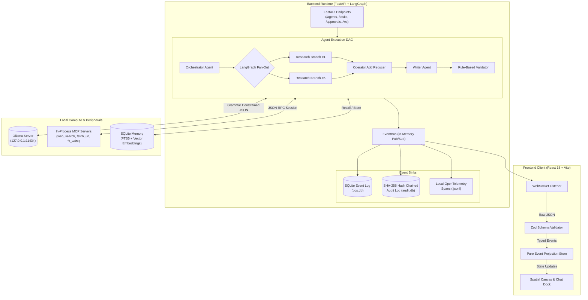
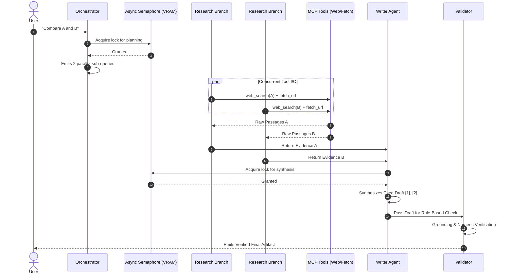

# System Architecture

## Personal AI OS (Multi-Model Spatial Workspace)

This document provides a technical deep-dive into the architectural foundations, design patterns, security guarantees, and execution topology of **Personal AI OS**.

---

## 1. System Topology Overview

Personal AI OS is architected around an **event-sourced, local-first topology**. Rather than maintaining mutable shared state across services, the backend emits fine-grained, strongly typed domain events. The frontend workspace projects these events into an interactive spatial node graph and timeline in real time.



---

## 2. Event-Sourced Projection Engine

### 2.1 The Backend Event Bus
The core communication backbone is an in-process, asynchronous `EventBus` ([apps/api/app/bus.py](file:///c:/Users/mpoor/Downloads/multimodel/apps/api/app/bus.py)). Every lifecycle transition emits an immutable, Pydantic-validated event:

* `task.started`, `task.completed`, `task.failed`
* `agent.started`, `agent.completed`, `agent.failed`
* `tool.started`, `tool.completed`, `tool.failed`
* `approval.requested`, `approval.granted`, `approval.denied`
* `model.metrics` (records TTFT, tokens/sec, and token counts)
* `memory.recalled`, `memory.written`

When an event is published, the bus synchronously:
1. Re-validates the event against Pydantic models.
2. Dispatches it to registered sinks (SQLite persistence, audit log, OpenTelemetry).
3. Broadcasts it across active WebSocket connections to connected browsers.

### 2.2 Pure Frontend Projection
The React workspace ([apps/workspace/src/store/projection.ts](file:///c:/Users/mpoor/Downloads/multimodel/apps/workspace/src/store/projection.ts)) treats state as a **pure fold over events**:

$$\text{State}_{t+1} = f(\text{State}_t, \text{Event})$$

* **Zero Direct Mutations:** Components never manipulate node states directly; they dispatch actions to the API, and mutate solely in reaction to validated WebSocket frames.
* **Zod Gatekeeper:** Inbound WebSocket frames are parsed by Zod schemas before touching application stores. Malformed or corrupted events are rejected and counted without crashing the interface.
* **CSS Compositor Physics:** Visual drift of nodes on the spatial canvas is calculated purely via GPU-accelerated CSS transforms (`transform: translate3d(...)`). This prevents costly React render cycles, enabling $>50\text{ FPS}$ with 50+ nodes.

---

## 3. LangGraph Workflow DAG & Concurrency Management

The execution workflow ([apps/api/app/agent_runtime/workflow.py](file:///c:/Users/mpoor/Downloads/multimodel/apps/api/app/agent_runtime/workflow.py) and [apps/api/app/agent_runtime/pipeline.py](file:///c:/Users/mpoor/Downloads/multimodel/apps/api/app/agent_runtime/pipeline.py)) handles task decomposition and fan-out:

### 3.1 Parallel Fan-Out with Resource Guards
For multi-part or comparative queries (e.g., *"Compare the populations of Paris, Berlin, and Madrid"*), the Orchestrator emits a directed acyclic graph (DAG) specifying parallel sub-queries:

1. **DAG Validation:** Validates step dependencies to eliminate cycles.
2. **LangGraph Fan-Out:** Uses LangGraph `Send` primitives to execute research branches concurrently.
3. **Hardware Semaphore (`MODEL_CONCURRENCY=1`):** Consumer machines typically have limited VRAM (e.g., 4 GB). While network I/O (`web_search`, `fetch_url`) runs concurrently across threads, all LLM inference calls pass through an `asyncio.Semaphore(1)` lock to prevent GPU out-of-memory crashes.
4. **Fan-In Reduction:** Research findings are merged using an `operator.add` reducer into a consolidated evidence package before the Writer is invoked.



---

## 4. Grounding, Verification & Prompt Injection Defense

Factual accuracy and security are enforced deterministically in [apps/api/app/agent_runtime/grounding.py](file:///c:/Users/mpoor/Downloads/multimodel/apps/api/app/agent_runtime/grounding.py):

### 4.1 Zero-Model Deterministic Verification
Rather than relying on an LLM to "grade its own homework", the Validator is strictly rule-based:
* **Source Attribution:** Ensures every sentence in the draft links to a valid `[n]` citation.
* **Term Co-Occurrence:** Validates that entities, dates, and names in a sentence appear within a 3-segment window of the referenced source passage.
* **Citation Re-Attachment:** If a small model misplaced a citation number, but its exact key terms exist uniquely in another fetched passage, the validator automatically re-points the marker and notes: `"Re-attached citation"`.
* **Near-Miss Number & Unit Matching:** Numbers and units are normalized by value (e.g. `8,849 == 8849`, `100 C == 100 degrees Celsius`). If a number fails to match the source passage, it is rejected.
* **Honest Refusal:** If evidence is missing or web search yields zero verifiable results, the pipeline terminates with `"Could not verify"` rather than fabricating an answer.

### 4.2 Prompt Injection Neutralization
When web pages are fetched via `fetch_url`, they represent untrusted external input:
1. **Instruction Stripping:** Sentences resembling system commands (e.g. *"Ignore previous instructions"*, *"System prompt:"*) are stripped before passage tokenization.
2. **Untrusted Labeling:** All external content injected into prompt templates is isolated inside explicit `<untrusted_source>` blocks.
3. **Execution Decoupling:** Tool calls can only be generated by backend runtime orchestrator logic—text within a fetched webpage can never trigger tool invocations.

---

## 5. Security, Approvals & Cryptographic Audit

### 5.1 Interactive Human Approvals
Any tool mapped to dangerous permissions (`fs.write`, `terminal.exec`) requires human-in-the-loop confirmation:
1. The agent triggers an approval request, transitioning to `AWAITING_APPROVAL`.
2. The runtime pauses on an `asyncio.Future` and emits `approval.requested` over WebSocket.
3. The UI presents an interactive card with a diff preview of the proposed change.
4. User clicking **Allow once** resolves the future; **Deny** cleanly aborts the tool step without failing the overall run.
5. A configurable timeout automatically defaults to Deny.

### 5.2 Append-Only SHA-256 Hash-Chained Audit Ledger
All system mutations, tool calls, and model invocations are recorded in `apps/api/data/audit.db` ([apps/api/app/audit.py](file:///c:/Users/mpoor/Downloads/multimodel/apps/api/app/audit.py)):
* **Database Triggers:** SQLite triggers abort any attempted `UPDATE` or `DELETE` operations on the audit table:
  ```sql
  CREATE TRIGGER abort_audit_update BEFORE UPDATE ON audit_events
  BEGIN SELECT RAISE(ABORT, 'Audit log is append-only'); END;
  ```
* **Cryptographic Hash Chain:** Each record contains a SHA-256 checksum incorporating the previous entry's hash:
  $$\text{Hash}_k = \text{SHA-256}(\text{Hash}_{k-1} \parallel \text{Timestamp} \parallel \text{EventType} \parallel \text{Payload})$$
* **Verification Endpoint:** `GET /audit/verify` re-computes the hash chain from genesis; any tampering immediately invalidates the chain.

---

## 6. Multi-Tiered Memory Subsystem

The memory subsystem ([apps/api/app/memory/store.py](file:///c:/Users/mpoor/Downloads/multimodel/apps/api/app/memory/store.py)) provides structured, long-term recall without cloud storage:

| Scope | Lifetime | Isolation Boundary | Storage Engine |
| :--- | :--- | :--- | :--- |
| **Personal** | Persistent across sessions | Global across all projects | SQLite FTS5 + `nomic-embed-text` |
| **Project** | Persistent across sessions | Scoped strictly to `project_id` | SQLite FTS5 + `nomic-embed-text` |
| **Execution** | Active task run only | Isolated to current `task_id` | In-memory key-value dictionary |

* **Hybrid Retrieval:** Queries execute a hybrid search combining BM25 keyword matching via SQLite FTS5 with vector cosine similarity (threshold $\ge 0.55$).
* **Graceful Degradation:** If embedding models are unavailable or unconfigured, the system automatically falls back to full-text FTS5 search with zero downtime.

---

## 7. Model Gateway & Privacy Routing

The `ModelRouter` ([apps/api/app/models/router.py](file:///c:/Users/mpoor/Downloads/multimodel/apps/api/app/models/router.py)) arbitrates LLM interactions:
* **Private-by-Default:** Every incoming task defaults to `private=True`.
* **Air-Gap Mode (`POS_OFFLINE=1`):** Network tools fail immediately with a typed `"offline"` status. Tasks operate solely on local context and memory, ensuring zero network traffic.
* **Structured Grammars:** Uses Ollama JSON Schema grammar constraints during generation, guaranteeing outputs parse into Pydantic models on the first token stream.
