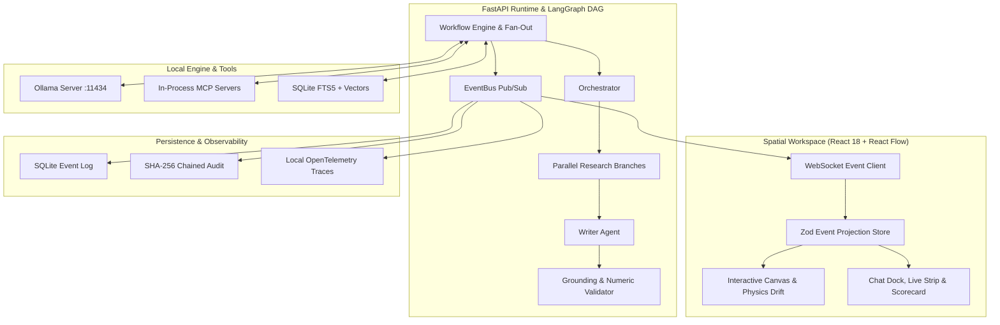

# Personal AI OS

<p align="center">
  <strong>A privacy-first, local-running spatial workspace for collaborative multi-agent intelligence.</strong>
</p>

<p align="center">
  
  
  
  
  
  
</p>

---

## Documentation Index

* **[PRD.md](PRD.md)**: Product vision, user personas, functional requirements, and milestone definitions.
* **[ARCHITECTURE.md](ARCHITECTURE.md)**: Technical topology, event-sourced projection, LangGraph DAG, and grounding engine.
* **[AGENTS.md](AGENTS.md)**: Declarative agent roster, capabilities, tools, permissions, and self-healing protocols.
* **[GATES.md](GATES.md)**: Phase gates (P1 Living Shell, P2 Real Brain, P3 Swarm+Trust, Q Quality) and verification evidence.
* **[docs/decisions/](docs/decisions/)**: Architecture Decision Records (ADR 0001 through ADR 0004).

---

## Key Highlights

* **100% Local & Privacy First:** Operates entirely on `127.0.0.1` using local Ollama models (`llama3.2:3b`, `phi3.5`). Zero cloud dependencies, zero external tracking, and an air-gap offline mode (`POS_OFFLINE=1`).
* **Spatial Multi-Agent Canvas:** Observe autonomous swarms in real time. Dynamic node graphs with GPU-accelerated CSS drift sustain $\ge 50\text{ FPS}$ with 50+ simultaneous nodes.
* **Zero-Model Factual Grounding:** Answers are validated against fetched web passages and local memory via a deterministic, rule-based verification engine. Claims cite sources (`[1]`, `[2]`), and unverified facts trigger honest refusals (*"Could not verify"*).
* **Human-in-the-Loop Safety:** Dangerous operations (`fs.write`, `terminal.exec`) pause execution and require explicit UI authorization ("Allow once" / "Deny").
* **Cryptographic Audit Ledger:** Every tool invocation, model metric, and human approval is immutably committed to an append-only, SHA-256 hash-chained SQLite ledger (`GET /audit/verify`).
* **Ultra-Lightweight Footprint:** Native Node & Python toolchain. No Docker, no Kubernetes, and no database servers required. Runs smoothly on consumer laptops with 4 GB VRAM.

---

## System Architecture



---

## Project Structure

```
multimodel/
├── agents/               # Declarative manifest.yaml specifications per agent
│   ├── orchestrator/     # Planning, delegation, and DAG construction
│   ├── research/         # Information retrieval (DuckDuckGo, Wikipedia)
│   ├── writer/           # Synthesis and report formatting
│   ├── validator/        # Factual verification and numeric normalization
│   ├── memory/           # Cross-session FTS5 and vector recall
│   └── coder/            # Script generation and terminal execution
├── apps/
│   ├── api/              # FastAPI backend, LangGraph runtime, SQLite stores
│   └── workspace/        # React 18, React Flow, TailwindCSS workspace
├── benchmarks/           # Answerability suite, soak testing, latency profiling
├── docs/                 # Architecture Decision Records (ADRs) and recorded demos
├── mcp/                  # MCP servers: web_search, fetch_url, fs_write
├── packages/
│   └── schemas/          # Cross-language contracts (Python Pydantic + TS Zod)
├── scripts/              # Native management scripts (setup, dev, check, preview)
├── PRD.md                # Product Requirements Document
├── ARCHITECTURE.md       # Technical architecture specification
├── AGENTS.md             # Agent swarm catalog and specifications
└── GATES.md              # Quality and phase completion checklists
```

---

## Prerequisites

Ensure you have **Python >= 3.10** and **Node.js >= 18** installed on your system PATH.

To run with real local inference, launch [Ollama](https://ollama.ai) (`127.0.0.1:11434`) and pull the core models:

```bash
ollama pull llama3.2:3b
ollama pull phi3.5
ollama pull nomic-embed-text    # for vector memory
```

*(Optional benchmark model: `ollama pull mistral:7b` — requires ~5 GB free RAM).*

> **Note:** Without Ollama running, the API still starts cleanly and handles missing models gracefully. Contract tests run with a built-in stub executor.

---

## Quick Start

The project runs completely native with zero global dependencies or admin privileges:

```bash
# 1. Setup Python virtual environment and npm dependencies
npm run setup

# 2. Launch FastAPI (:8000) and React Workspace (:5173) concurrently
npm run dev

# 3. Run full verification suite (Ruff, Pytest, TSC, ESLint, Vitest, Playwright)
npm run check

# 4. Build production workspace bundle
npm run build

# 5. Preview production build with live API
npm run preview
```

Configuration variables live in `.env.example`. Copy to `.env` to customize ports, providers, timeouts, and logging levels.

---

## Recorded Demo Walkthrough

Run the automated 9-scene end-to-end visual walkthrough:

```bash
# Offline demo with stub model & fictional corpus (instant, no Ollama needed)
npm run demo

# Live demo with real Ollama inference and web queries (runs pre-flight doctor first)
npm run demo -- --live
```

The script controls Microsoft Edge via Playwright, capturing captions, screenshots (`docs/demo/*.png`), video (`demo.webm`), and runtime metrics in [docs/demo/DEMO.md](docs/demo/DEMO.md).

---

## Verification & Manual Testing Checklists

### Phase 1: Spatial Shell
1. Open http://localhost:5173. 6 agent dots float on the canvas; pan, zoom, and drag freely.
2. Hover over any node to inspect its state tag; click to view permissions and capabilities.
3. Chat dock responds smoothly down to 390px with zero horizontal layout shift.
4. Stress test canvas performance at `http://localhost:5173/?stress=50` (sustains $\ge 50\text{ FPS}$).

### Phase 2: Autonomous Brain
1. Start Ollama and verify `GET /api/health` reports `"executor": "real"`.
2. Ask a factual question (e.g. *"Who is CM of Telangana?"*).
3. Observe live pipeline progression: Orchestrator plans, Research invokes MCP search and fetch tools, Writer synthesizes draft, Validator verifies claims.
4. Verify answer includes numbered source citations (`[1]`) with active URL links.
5. Ask to save output to disk: verify interactive **Approval needed** card blocks execution until approved.

### Phase 3: Parallel Swarm, Memory & Trust
1. **Parallel Execution:** Ask *"Compare the populations of Lyon, Marseille, and Nice"*. Multiple `Research #1..#3` branches execute concurrently.
2. **Persistent Memory:** Store a memory under project `alpha` (*"Remember that the launch code is Falcon"*). Switch to project `beta` and verify isolation; switch back to `alpha` and verify recall.
3. **Cryptographic Audit:** Inspect http://localhost:8000/audit and verify the SHA-256 hash chain at http://localhost:8000/audit/verify.
4. **Air-Gap Mode:** Launch with `POS_OFFLINE=1` (`$env:POS_OFFLINE=1; npm run dev`). Web tools fail fast, and queries answer from local memory or exit with honest refusal.

---

## License

Distributed under the [MIT License](LICENSE).
