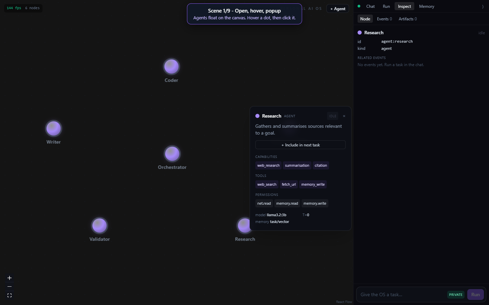
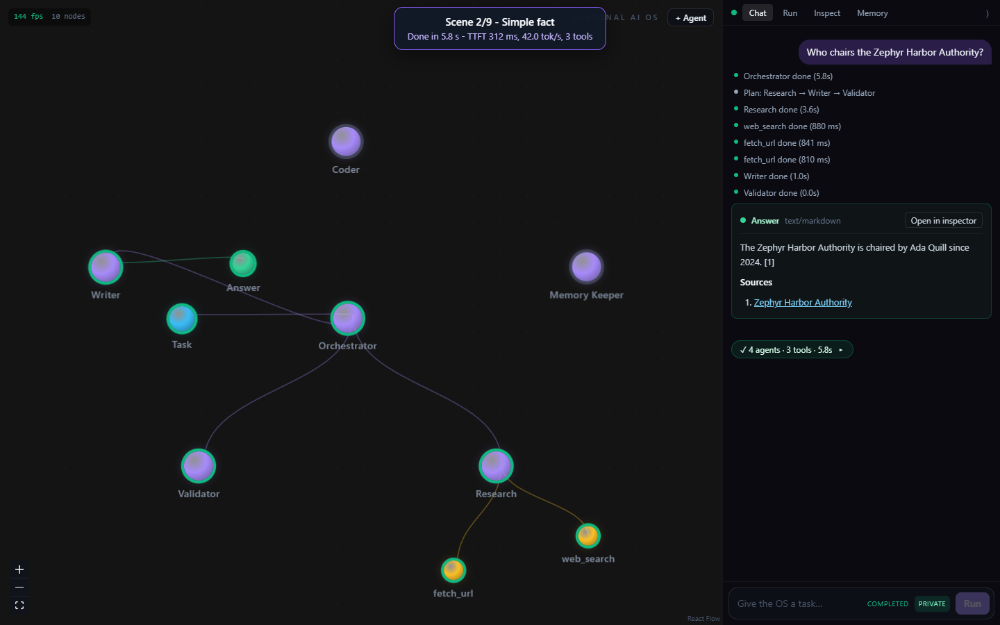
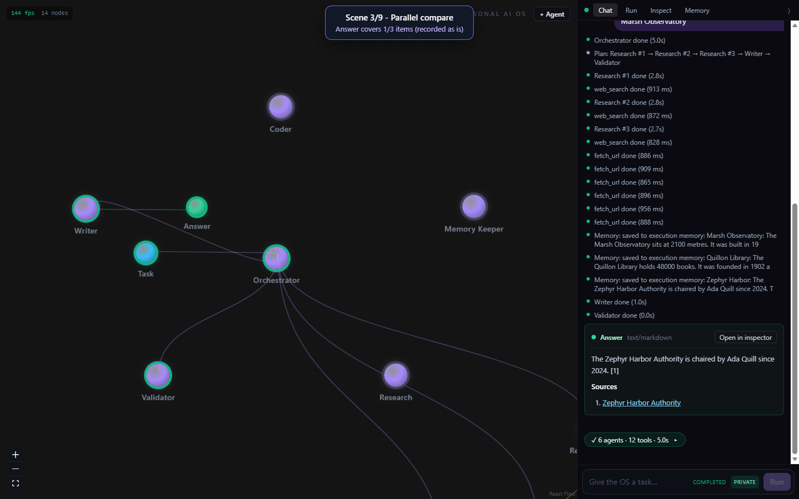
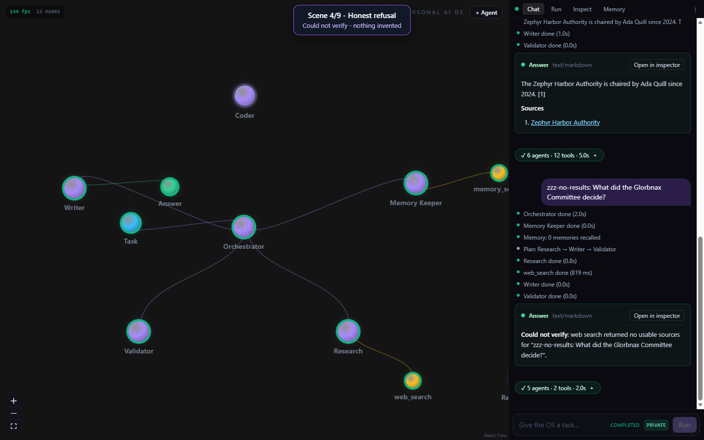
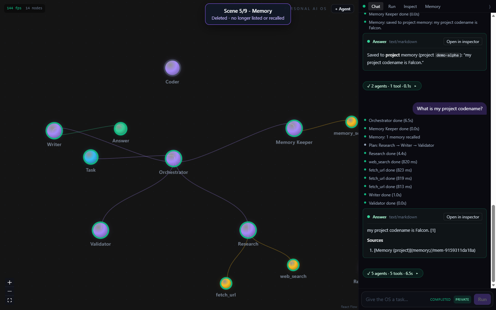
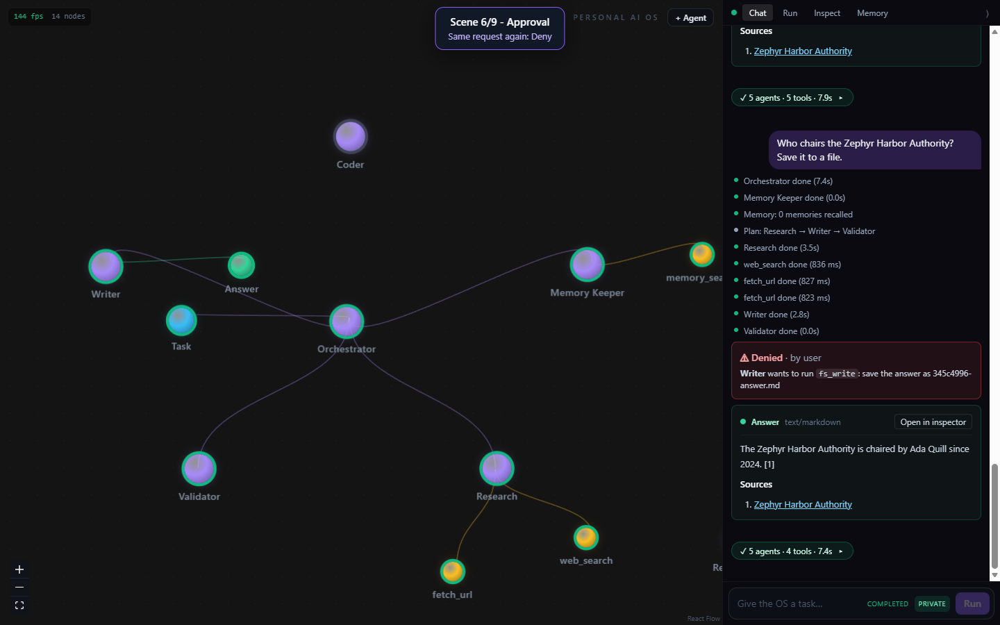
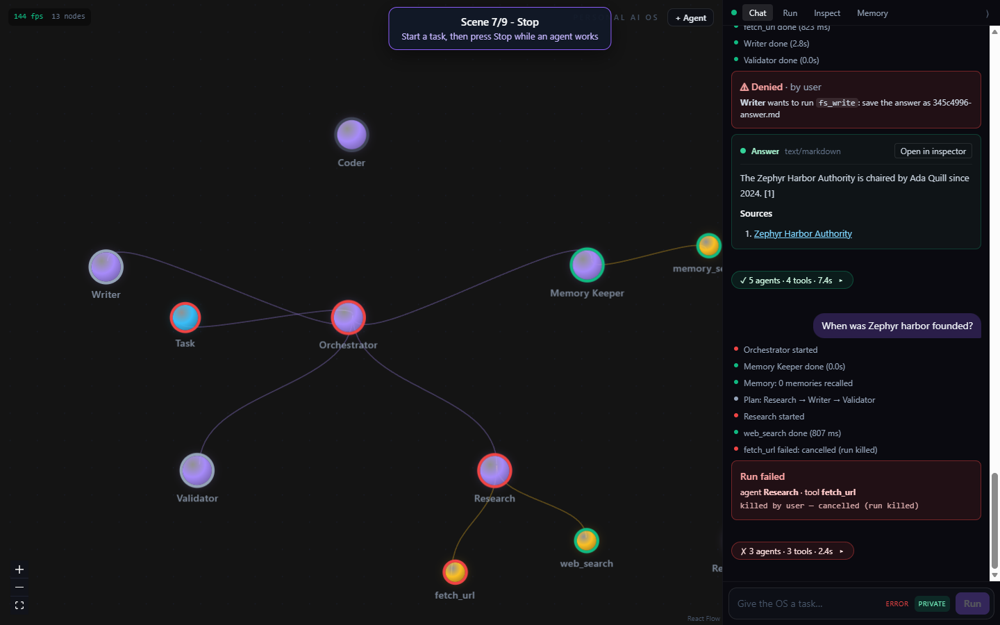
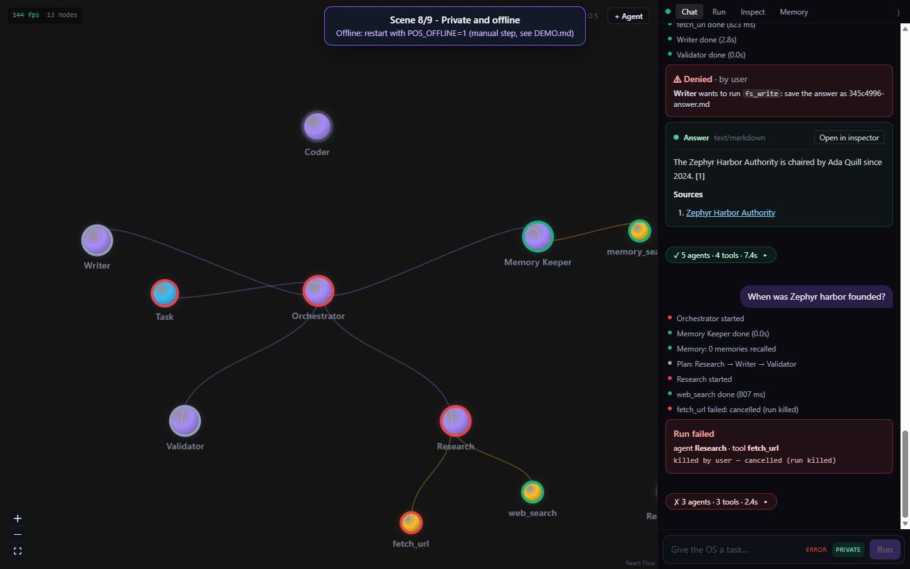
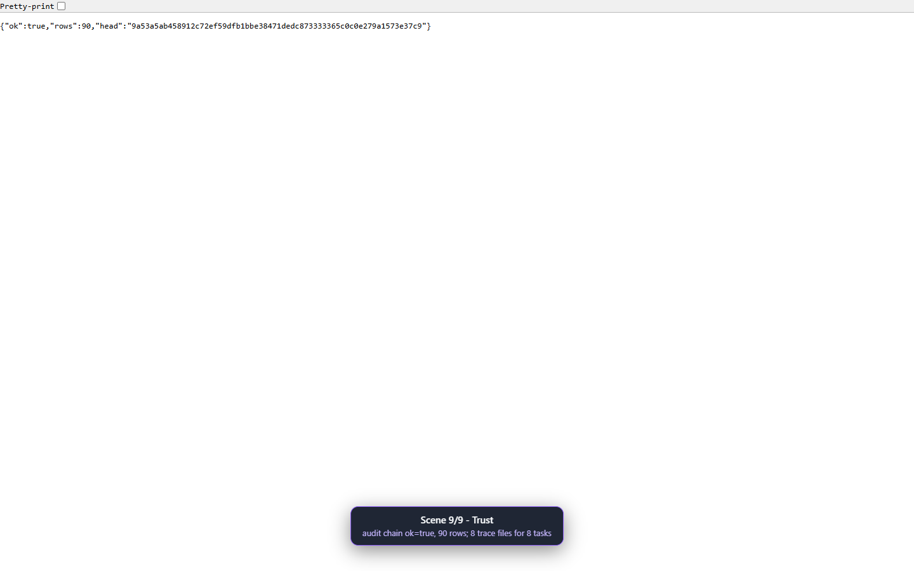

# Personal AI OS - recorded demo

Recorded 2026-10-03 17:41:20 UTC by `npm run demo`.
Mode: **stub** - deterministic stub model + offline fictional test corpus (no Ollama, no internet). The corpus only knows fictional places (Zephyr Harbor, Quillon Library, Marsh Observatory), so stub mode types corpus questions; the live question for each scene is listed next to it. TTFT and tok/s in stub mode are the stub's simulated numbers, not a model's.

Video: `demo.webm` (whole walkthrough). Screenshots: `NN-name.png`, one per scene.

Outcome column: **as expected** or **DIFFERS** (recorded as it happened, never retried).

| # | scene | typed | outcome | agents | TTFT ms | tok/s | tools | seconds |
|---|---|---|---|---|---|---|---|---|
| 1 | Open, hover, popup | - | as expected | - | - | - | - | - |
| 2 | Simple fact | `Who chairs the Zephyr Harbor Authority?` | as expected | orchestrator, research, writer, validator | 312 | 42.0 | 3 | 5.8 |
| 3 | Parallel compare (multi-branch) | `Compare Zephyr Harbor, Quillon Library and Marsh Observatory` | **DIFFERS** | orchestrator, research#1, research#2, research#3, writer, validator | 312 | 42.0 | 12 | 5.0 |
| 4 | Honest refusal | `zzz-no-results: What did the Glorbnax Committee decide?` | as expected | orchestrator, memory, research, writer, validator | 312 | 42.0 | 2 | 2.0 |
| 5 | Memory: remember, recall, switch project, delete | `Remember that my project codename is Falcon` `What is my project codename?` | as expected | orchestrator, memory, research, writer, validator | 312 | 42.0 | 5 | 6.5 |
| 6 | Approval: Allow once, then Deny | `Who chairs the Zephyr Harbor Authority? Save it to a file.` `Who chairs the Zephyr Harbor Authority? Save it to a file.` | as expected | orchestrator, memory, research, writer, validator | 312 | 42.0 | 4 | 7.4 |
| 7 | Stop mid-run | `When was Zephyr harbor founded?` | as expected | orchestrator, memory, research | 312 | 42.0 | 2 | 2.4 |
| 8 | Private toggle and offline mode | - | as expected | - | - | - | - | - |
| 9 | Trust: audit chain and traces | - | as expected | - | - | - | - | - |

## 1. Open, hover, popup

- **Expected:** floating agent dots; hover shows a name tag at the cursor; click opens a popup with tools and permissions
- **What appeared:** 6 agent dots; hover tag "Writer IDLE"; popup: Research AGENT IDLE x Gathers and summarises sources relevant to a goal. + Include in next task CAPABILITIES web_research summarisation citation TOOLS web_search fetch_url memory_write PERMISSIONS net
- **Outcome:** as expected

## 2. Simple fact

Live mode types: `who is cm of telangana`

- **Expected:** Orchestrator -> Research -> Writer -> Validator; tool dots light up; TTFT and tok/s shown; answer cites [1]; names Ada Quill
- **What appeared:** [ok] 4 agents | 3 tools | 5.8s; answer names Ada Quill: The Zephyr Harbor Authority is chaired by Ada Quill since 2024. [1] **Sources** 1. [Zephyr Harbor Authority](https://example.org/zephyr-harbor)
- **Outcome:** as expected
- Run `Who chairs the Zephyr Harbor Authority?`: execution.completed; agents orchestrator, research, writer, validator; tools web_search, fetch_url, fetch_url; model calls 3; TTFT 312 ms; 42.0 tok/s; 5.8 s; chip "[ok] 4 agents | 3 tools | 5.8s"
  - Answer: The Zephyr Harbor Authority is chaired by Ada Quill since 2024. [1] **Sources** 1. [Zephyr Harbor Authority](https://example.org/zephyr-harbor)

## 3. Parallel compare (multi-branch)

Live mode types: `Compare the heights of Mount Everest, K2 and Kangchenjunga`

- **Expected:** several research branches active at once ('N agents working'); a cited comparison
- **What appeared:** 3 research branches; strip said "3 agents working: Research #1, Research #2, Research #3"; [ok] 6 agents | 12 tools | 5.0s; answer names 1/3 compared items; answer: The Zephyr Harbor Authority is chaired by Ada Quill since 2024. [1] **Sources** 1. [Zephyr Harbor Authority](https://example.org/zephyr-harbor)
- **Outcome:** DIFFERS from the expectation (recorded as is)
- **Note:** The branches ran in parallel, but the answer is not a comparison: it does not mention Quillon, Marsh. (Stub model: its writer answers from the first cited source only.)
- Run `Compare Zephyr Harbor, Quillon Library and Marsh Observatory`: execution.completed; agents orchestrator, research#1, research#2, research#3, writer, validator; tools web_search, web_search, web_search, fetch_url, fetch_url, fetch_url, fetch_url, memory_write, fetch_url, memory_write, fetch_url, memory_write; model calls 2; TTFT 312 ms; 42.0 tok/s; 5.0 s; chip "[ok] 6 agents | 12 tools | 5.0s"
  - Answer: The Zephyr Harbor Authority is chaired by Ada Quill since 2024. [1] **Sources** 1. [Zephyr Harbor Authority](https://example.org/zephyr-harbor)

## 4. Honest refusal

Live mode types: `What did the Glorbnax Committee decide?`

- **Expected:** 'Could not verify' with the sources checked; no invented answer
- **What appeared:** [ok] 5 agents | 2 tools | 2.0s; answer: **Could not verify**: web search returned no usable sources for "zzz-no-results: What did the Glorbnax Committee decide?".
- **Outcome:** as expected
- Run `zzz-no-results: What did the Glorbnax Committee decide?`: execution.completed; agents orchestrator, memory, research, writer, validator; tools memory_search, web_search; model calls 1; TTFT 312 ms; 42.0 tok/s; 2.0 s; chip "[ok] 5 agents | 2 tools | 2.0s"
  - Answer: **Could not verify**: web search returned no usable sources for "zzz-no-results: What did the Glorbnax Committee decide?".

## 5. Memory: remember, recall, switch project, delete

- **Expected:** 'Memory: saved...' line; recall answers Falcon citing memory; another project sees nothing; Delete removes it
- **What appeared:** write: Saved to **project** memory (project `demo-alpha`): "my project codename is Falcon."; recall: my project codename is Falcon. [1] **Sources** 1. [Memory (project)](memory://mem-9159311da18a); listed in demo-alpha: 1; visible in demo-beta: 0; after Delete: 0
- **Outcome:** as expected
- Run `Remember that my project codename is Falcon`: execution.completed; agents orchestrator, memory; tools memory_write; model calls 0; TTFT - ms; - tok/s; 0.1 s; chip "[ok] 2 agents | 1 tool | 0.1s"
  - Answer: Saved to **project** memory (project `demo-alpha`): "my project codename is Falcon."
- Run `What is my project codename?`: execution.completed; agents orchestrator, memory, research, writer, validator; tools memory_search, web_search, fetch_url, fetch_url, fetch_url; model calls 3; TTFT 312 ms; 42.0 tok/s; 6.5 s; chip "[ok] 5 agents | 5 tools | 6.5s"
  - Answer: my project codename is Falcon. [1] **Sources** 1. [Memory (project)](memory://mem-9159311da18a)

## 6. Approval: Allow once, then Deny

Live mode types: `Research Mount Everest height and save the answer to a file`

- **Expected:** amber approval card; Allow once writes the file (fs_write runs); Deny skips the write and still answers
- **What appeared:** Allow: fs_write ran, [ok] 5 agents | 5 tools | 7.9s; Deny: fs_write skipped, [ok] 5 agents | 4 tools | 7.4s; answer after Deny: The Zephyr Harbor Authority is chaired by Ada Quill since 2024. [1] **Sources** 1. [Zephyr Harbor Authority](https://example.org/zephyr-harb
- **Outcome:** as expected
- Run `Who chairs the Zephyr Harbor Authority? Save it to a file.`: execution.completed; agents orchestrator, memory, research, writer, validator; tools memory_search, web_search, fetch_url, fetch_url, fs_write; model calls 3; TTFT 312 ms; 42.0 tok/s; 7.9 s; chip "[ok] 5 agents | 5 tools | 7.9s"
  - Answer: The Zephyr Harbor Authority is chaired by Ada Quill since 2024. [1] **Sources** 1. [Zephyr Harbor Authority](https://example.org/zephyr-harbor)
- Run `Who chairs the Zephyr Harbor Authority? Save it to a file.`: execution.completed; agents orchestrator, memory, research, writer, validator; tools memory_search, web_search, fetch_url, fetch_url; model calls 3; TTFT 312 ms; 42.0 tok/s; 7.4 s; chip "[ok] 5 agents | 4 tools | 7.4s"
  - Answer: The Zephyr Harbor Authority is chaired by Ada Quill since 2024. [1] **Sources** 1. [Zephyr Harbor Authority](https://example.org/zephyr-harbor)

## 7. Stop mid-run

Live mode types: `How tall is K2?`

- **Expected:** agent turns red, chat says 'killed by user', chip shows a cross
- **What appeared:** [x] 3 agents | 3 tools | 2.4s; ERROR: killed by user
- **Outcome:** as expected
- Run `When was Zephyr harbor founded?`: execution.failed; agents orchestrator, memory, research; tools memory_search, web_search; failed fetch_url: cancelled (run killed); model calls 1; TTFT 312 ms; 42.0 tok/s; 2.4 s; chip "[x] 3 agents | 3 tools | 2.4s"
  - Answer: ERROR: killed by user

## 8. Private toggle and offline mode

- **Expected:** toggle flips Private <-> Cloud ok (cloud stays disabled without a key); offline is a documented restart step
- **What appeared:** aria-pressed true -> false -> true; GET /api/runtime = {"offline":false,"cloud_available":false,"cloud_kinds":[]}
- **Outcome:** as expected
- **Note:** Offline mode is not automated (it needs an API restart); the steps are under 'Offline mode' below.

## 9. Trust: audit chain and traces

- **Expected:** /api/audit/verify says ok with a hash head; one trace file per task
- **What appeared:** verify {"ok":true,"rows":90,"head":"9a53a5ab458912c72ef59dfb1bbe38471dedc873333365c0c0e279a1573e37c9"}; trace files 8; tasks 8
- **Outcome:** as expected

## Offline mode (scene 8, manual step)

Offline mode needs an API restart, which the demo does not automate:

1. Stop `npm run dev` (Ctrl+C).
2. PowerShell: `$env:POS_OFFLINE=1; npm run dev` (bash: `POS_OFFLINE=1 npm run dev`).
3. Ask a web question: Events show `tool.failed "offline: network tools are disabled (POS_OFFLINE=1)"` and the answer is "Could not verify".
4. Ask a question answered from memory (scene 5): it still answers. `GET /api/runtime` shows `"offline": true`.
